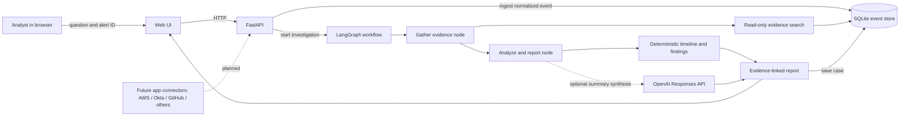

# SecOps Investigation Copilot

A local-first, read-only security investigation portfolio project. It accepts normalized
security events from multiple products, correlates evidence into a timeline, and presents
human-readable findings with source event IDs. Synthetic AWS, Okta, and GitHub evidence is
included so the demo works without vendor accounts or an API key.

## Architecture at a glance



Solid lines are implemented in this MVP. Dashed lines show planned connector integrations.
The current app has a normalized event ingestion endpoint rather than live vendor polling or
webhooks. For the detailed module map, workflow graph, data flow, and current boundaries, see
[Architecture](docs/architecture.md). For local setup, API use, and optional model configuration,
see the [Startup Guide](docs/startup-guide.md).

To verify an OpenAI API key and model access, follow the [API key check steps](docs/startup-guide.md#5-optional-hosted-gpt-61-terra-synthesis).

## Quick start

Requires Python 3.11 or newer. In PowerShell:

```powershell
cd secops-investigation-agent
python -m venv .venv
.\.venv\Scripts\Activate.ps1
python -m pip install -e .
if (-not (Test-Path .env)) { Copy-Item .env.example .env }
uvicorn src.api:app --reload
```

Open <http://127.0.0.1:8000>. The sample dataset is seeded into SQLite on first start. API
documentation is available at <http://127.0.0.1:8000/docs>.

## Current API

- `GET /api/health` — status and active model mode
- `GET /api/events` — list normalized evidence
- `POST /api/events` — ingest one normalized event
- `POST /api/investigations` — investigate an alert or analyst question
- `GET /api/investigations` — list saved investigation reports

## Safety and scope

The app is a local portfolio MVP, **not ready to expose publicly**: it has no user authentication,
tenant isolation, durable work queue, or live vendor connectors. It performs read-only analysis;
it cannot isolate devices, disable accounts, revoke credentials, or change cloud permissions.
Event content is untrusted evidence, not instructions. Timeline ordering and evidence references
are computed by application code; hosted model use is optional and limited to report summary
synthesis. Use synthetic or sanitized logs in demos.
